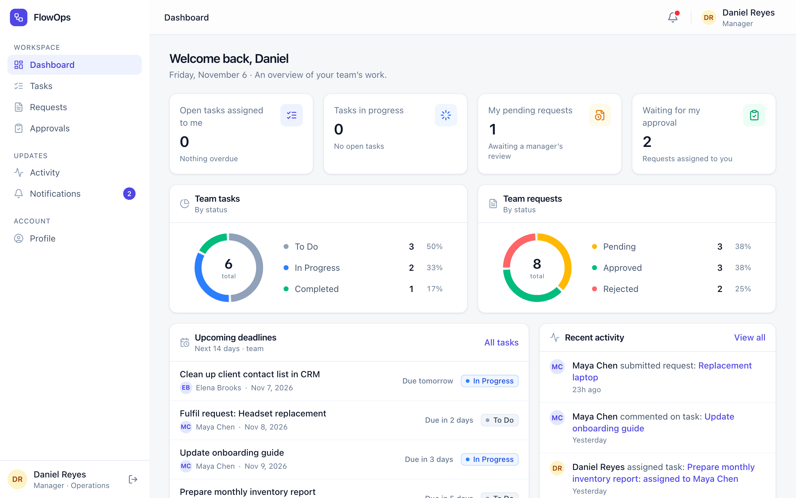
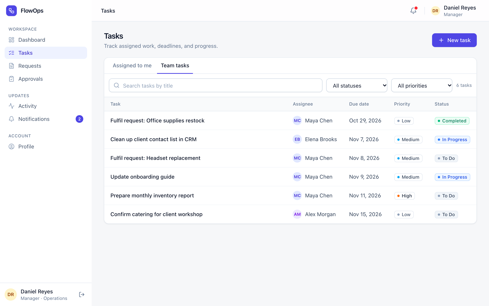
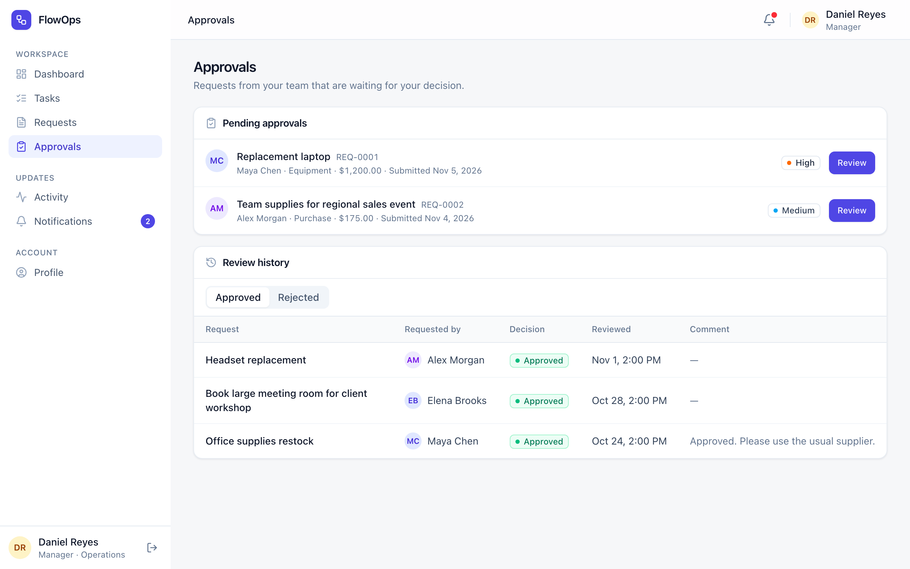

# FlowOps

FlowOps is an internal web app for a small company to manage everyday operations. Employees submit requests (equipment, purchases, IT support) and work on assigned tasks. Managers approve or reject requests and assign work to their team. Administrators manage user accounts. Every important change is recorded in an activity history, and users get in-app notifications.

## Features

- Login with cookie-based sessions and three roles: Employee, Manager, Admin
- Role-based dashboard with task counts, pending requests, upcoming deadlines, and recent activity
- Tasks: create, assign, edit, delete, change status, set priority and due date, comment, search, and filter
- Requests: submit, track status, comment, and view review history
- Approvals: managers approve or reject assigned requests (a reason is required to reject). Approved equipment and purchase requests create a follow-up task.
- In-app notifications with read/unread state
- Activity timeline for tasks, requests, and user changes
- User management for admins: create users, assign roles and departments, deactivate accounts

## Technologies

- **Frontend:** React, Vite, Tailwind CSS, React Router, Axios
- **Backend:** Node.js, Express, express-session, Zod, bcrypt
- **Database:** PostgreSQL with Prisma ORM (run with Docker Compose)
- **Testing:** Vitest, Supertest, React Testing Library, Playwright

## Setup

Requirements: Node.js 20+, npm, and Docker.

1. Start PostgreSQL. It runs on port **5433** so it doesn't clash with a local Postgres. This also creates a `flowops_test` database for the tests.

   ```bash
   docker compose up -d
   ```

2. Set up the backend:

   ```bash
   cd backend
   npm install
   cp .env.example .env          # then set SESSION_SECRET to a long random string
   npx prisma migrate deploy
   npm run db:seed
   npm run dev                    # API on http://localhost:4000
   ```

3. In a second terminal, start the frontend:

   ```bash
   cd frontend
   npm install
   npm run dev                    # app on http://localhost:3000
   ```

### Demo accounts

All seeded accounts use the password `Password123!`. The people and data are fictional.

| Role     | Email               |
| -------- | ------------------- |
| Admin    | admin@flowops.test  |
| Manager  | daniel@flowops.test |
| Manager  | priya@flowops.test  |
| Employee | maya@flowops.test   |
| Employee | jordan@flowops.test |

### Running tests

```bash
# Backend API tests (uses the flowops_test database)
cd backend
cp .env.test.example .env.test
npm run db:test:setup
npm test

# Frontend unit tests
cd frontend
npm test

# End-to-end tests (first time: npx playwright install chromium)
# Starts its own servers on ports 3100/4100 and re-seeds only the flowops_test database.
npm run test:e2e
```

## Screenshots

**Dashboard**


**Tasks**


**Approvals**


## Known limitations

- Notifications refresh when you change pages. They are not pushed in real time.
- Only the assigned manager can review a request. If that manager is deactivated, their pending requests can't be reassigned from the UI.
- Departments come from the seed data. There is no screen to add or rename them.
- There is no password reset by email. An admin creates accounts with a temporary password.
